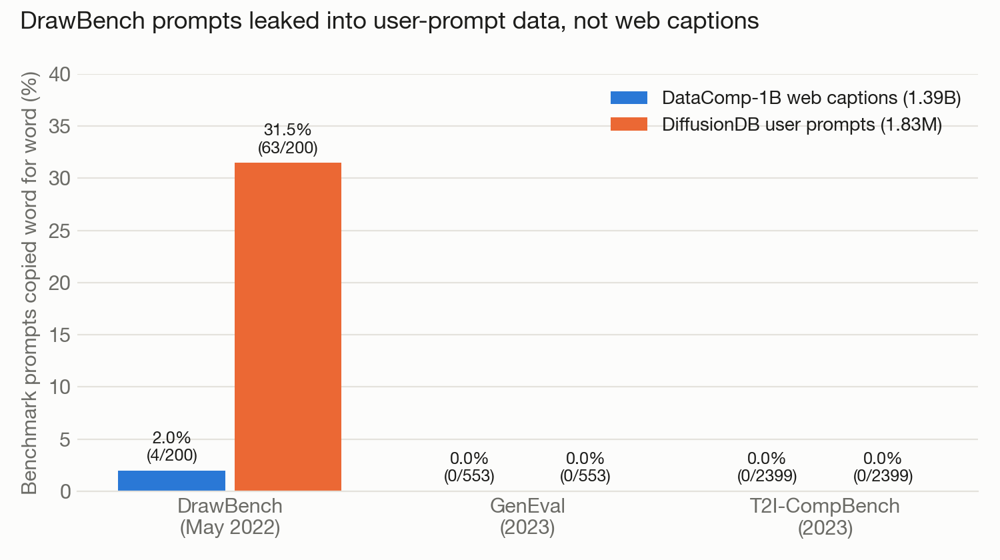
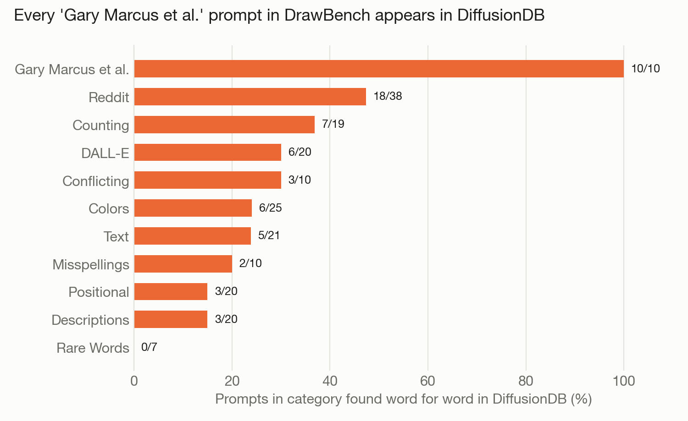

# t2i-benchmark-contamination

This project tests whether the prompts used to evaluate text-to-image models appear in the data those models are trained on. Prompts from three widely used benchmarks (DrawBench, GenEval, T2I-CompBench) were searched for in 1.39B web captions from [DataComp-1B](https://huggingface.co/datasets/mlfoundations/datacomp_1b) and 1.83M user prompts from [DiffusionDB](https://github.com/poloclub/diffusiondb).

Web captions are largely clean, but 63 of DrawBench's 200 prompts (31.5%) appear verbatim in DiffusionDB.



| | prompts | in DataComp-1B | in DiffusionDB |
|---|--:|--:|--:|
| DrawBench | 200 | 4 | 63 |
| GenEval | 553 | 0 | 0 |
| T2I-CompBench | 2,399 | 0 | 0 |

The timeline is consistent with this pattern. DrawBench was released with Imagen in May 2022, and DiffusionDB was collected from the Stable Diffusion Discord in August 2022. A likely explanation is that users testing a new model paste in well-known benchmark prompts, which the prompt log then records. GenEval and T2I-CompBench were released in 2023, after DiffusionDB was collected, so they could not have leaked into it.

The most prominent prompts leaked most often. All 10 prompts in DrawBench's "Gary Marcus et al." category appear (e.g., the donkey and octopus playing tug-of-war, and the Supreme Court justices playing baseball against the FBI), as do two of its deliberate misspellings, "Tcennis rpacket" and "Bzaseball galove".



The 4 DrawBench matches in DataComp all come from the "Descriptions" category, which uses dictionary definitions ("A mechanical or electrical device for measuring time."). Stock photo sites caption images with the same definitions, so these matches are coincidental rather than leaks.

## Method

All text is lowercased and stripped of punctuation, and the 3,152 prompts are matched simultaneously with Aho-Corasick. A prompt counts as a match if it forms the entire caption or a whole-word span within a longer one.

DataComp is roughly 340GB of parquet files, so `match_corpus.py` streams it: each file is downloaded, scanned, and deleted. The full run took about 6 hours on a MacBook with 8GB of RAM and no GPU.

Raw matches contain substantial noise; short GenEval prompts such as "a photo of a teddy bear" occur naturally in web captions. Every match for a prompt of 6+ words, plus every short DrawBench match, was therefore labeled as a leak or as generic: 111 matches in total, listed in [`results/review.csv`](results/review.csv). A distinctive prompt copied whole counts as a leak; a short everyday phrase within an unrelated caption counts as generic. Labels were assigned by rule, reviewed with Claude, and spot-checked by the author; the `labeled_by` column records which.

## Limitations

- Presence in a dataset does not show that a given model was trained on it or that its scores are inflated.
- Only near-exact copies are detected, so paraphrased leaks are missed and the counts are lower bounds.
- LAION (withdrawn in 2023) and Midjourney prompts (JourneyDB) have not yet been checked.

## Reproducing the results

```bash
python3 -m venv .venv && .venv/bin/pip install -r requirements.txt
.venv/bin/python scripts/build_prompts.py data/raw data/prompts.jsonl
.venv/bin/python scripts/match_corpus.py data/prompts.jsonl results/matches /tmp/dl     # ~6 hrs, restartable
.venv/bin/python scripts/match_diffusiondb.py data/prompts.jsonl results/diffusiondb_matches /tmp/dl_ddb
.venv/bin/python scripts/summarize.py data/prompts.jsonl results/matches results
.venv/bin/python scripts/summarize.py data/prompts.jsonl results/diffusiondb_matches results/diffusiondb
.venv/bin/python scripts/final_counts.py
.venv/bin/python scripts/make_charts.py
```

Benchmarks: DrawBench (Saharia et al. 2022), GenEval (Ghosh et al. 2023), T2I-CompBench (Huang et al. 2023). Data: DataComp (Gadre et al. 2023, CC-BY-4.0), DiffusionDB (Wang et al. 2022, CC0).
